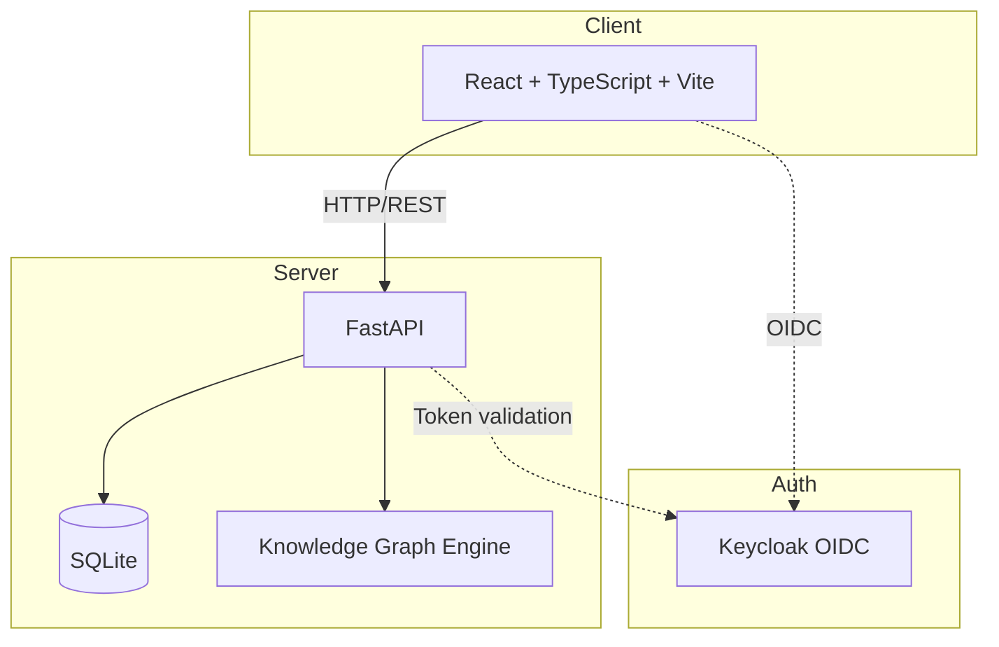

# Prism Studio

> Work in progress. This checkpoint may be incomplete or fail tests. See PLAN.md and STATUS.md before use.


Turn any codebase, with its docs, SQL schemas, configs, and PDFs, into a queryable knowledge graph. A `/graphify` skill for Claude Code, Cursor, Codex, and Gemini CLI: local deterministic AST parsing, every edge explained, no vector store.

**Prism Studio** — Ryan Vo | AI & Machine Learning

## Overview

Prism Studio parses codebases into a structured knowledge graph using deterministic AST analysis. Every node (function, class, import, schema element) and edge (calls, imports, inheritance, references) is extracted from source code without relying on vector embeddings or LLMs. Optional LLM-powered explanations provide advisory context grounded in actual graph data.

### Problem

Developers need to understand large, unfamiliar codebases quickly. Traditional search and grep miss semantic relationships. Vector-based RAG loses precision and hallucinates connections.

### Approach

- **Deterministic parsing**: Language-specific AST parsers extract typed nodes and edges
- **Queryable graph**: SQLite-backed storage with filtering, pagination, and export
- **No vector store**: Exact structural relationships, no embedding drift
- **LLM as advisor**: Optional explanations labeled advisory, grounded in real graph data

## Features

- **Multi-language AST parsing**: Python (v1), TypeScript/JavaScript, SQL, YAML (planned)
- **Graph query API**: Filter by node/edge type, file path; paginated results
- **Export formats**: JSON, GraphML for external tooling
- **React dashboard**: File tree, graph visualization, search, detail panels
- **OIDC authentication**: Keycloak with PKCE, realm import for SAML brokering
- **Docker deployment**: Compose stack with persistent volumes

## Quick Start

### Prerequisites

- Docker and Docker Compose
- Or: Python 3.12+, Node 24+, pnpm/npm

### Docker (Recommended)

```bash
cp .env.example .env
docker compose up -d
```

- Frontend: http://localhost:5173
- Backend API: http://localhost:8000
- Keycloak: http://localhost:8080 (admin/admin)

### Local Development

```bash
# Backend
cd backend
python -m venv .venv
source .venv/bin/activate
pip install -r requirements.txt
cp ../.env.example .env
uvicorn app.main:app --reload

# Frontend (new terminal)
cd frontend
npm install
npm run dev
```

## API Reference

### Health

- `GET /health` — Full health check with database connectivity
- `GET /health/ready` — Readiness probe

### Graph (v1)

- `GET /api/v1/graph` — Query graph with filters
  - Query params: `node_type`, `edge_type`, `file_path`, `limit`, `offset`
- `POST /api/v1/graph/parse` — Parse a codebase path
  - Body: `{ "path": "/absolute/path/to/code" }`
- `GET /api/v1/graph/export` — Export graph
  - Query: `format=json|graphml`

## Architecture



## AI/ML Evaluation

Prism Studio's core is a deterministic AST parser — not an ML model. The "AI/ML" classification reflects:

1. **Developer tooling for AI workflows**: Output feeds directly into LLM context windows for code understanding tasks
2. **Optional LLM explanations**: Advisory edge summaries using configurable providers (OpenAI-compatible, Anthropic, Gemini, Ollama)
3. **Agent skill target**: Designed as a `/graphify` skill for coding agents

### Reproducible Baseline

```bash
# Parse a Python repo and count nodes/edges
curl -X POST http://localhost:8000/api/v1/graph/parse \
  -H "Content-Type: application/json" \
  -d '{"path": "/path/to/python/project"}'

# Query results
curl "http://localhost:8000/api/v1/graph?limit=10"
```

### Metrics (v1 target)

| Metric | Target |
|--------|--------|
| Python parse accuracy (functions/classes) | >99% |
| Edge recall (calls/imports/inheritance) | >95% |
| Parse speed (10k LOC) | <5s |
| Memory (10k LOC) | <200MB |

### Failure Cases

- Dynamic imports (`importlib`, `__import__`) not resolved
- Decorators altering function signatures not fully modeled
- Type hints in comments (`# type: ignore`) not parsed
- Cross-file inference limited to explicit imports

## Security Limitations

- Demo Keycloak credentials (admin/admin) — **change in production**
- SQLite not suitable for concurrent multi-user production
- No rate limiting on API endpoints
- LLM API keys only server-side; never exposed to frontend
- CORS configured for localhost only by default

## Provider Configuration

| Provider | Env Var | Default Base URL | Models |
|----------|---------|------------------|--------|
| OpenAI-compatible | `LLM_PROVIDER=openai` | `https://api.openai.com/v1` | gpt-4o, gpt-4o-mini |
| Anthropic | `LLM_PROVIDER=anthropic` | `https://api.anthropic.com` | claude-3-5-sonnet |
| Gemini | `LLM_PROVIDER=gemini` | `https://generativelanguage.googleapis.com` | gemini-1.5-pro |
| Ollama | `LLM_PROVIDER=ollama` | `http://localhost:11434/v1` | llama3, codellama |

## SSO / SAML Setup

Keycloak supports SAML identity providers via identity brokering:

1. Configure SAML IdP in Keycloak Admin Console → Identity Providers → SAML v2.0
2. Map SAML attributes to Keycloak roles (viewer, analyst, admin)
3. Update `prism-frontend` client to use the broker
4. Users authenticate via corporate SAML, receive Keycloak tokens

See `docs/saml-setup.md` for detailed steps.

## Backup / Restore

```bash
# Backup
docker compose exec backend cp /app/data/prism.db /app/data/prism.db.backup
docker compose cp backend:/app/data/prism.db.backup ./prism.db.backup

# Restore
docker compose cp ./prism.db.backup backend:/app/data/prism.db
docker compose restart backend
```

## TLS / Reverse Proxy

For production, terminate TLS at a reverse proxy (nginx, Traefik, Caddy):

```nginx
server {
    listen 443 ssl;
    server_name prism.example.com;

    ssl_certificate /etc/letsencrypt/live/prism.example.com/fullchain.pem;
    ssl_certificate_key /etc/letsencrypt/live/prism.example.com/privkey.pem;

    location / {
        proxy_pass http://frontend:80;
    }

    location /api {
        proxy_pass http://backend:8000;
    }

    location /auth {
        proxy_pass http://keycloak:8080;
    }
}
```

## License

MIT License

Copyright (c) 2026 Ryan Vo <ryandtvo@gmail.com>

Permission is hereby granted, free of charge, to any person obtaining a copy
of this software and associated documentation files (the "Software"), to deal
in the Software without restriction, including without limitation the rights
to use, copy, modify, merge, publish, distribute, sublicense, and/or sell
copies of the Software, and to permit persons to whom the Software is
furnished to do so, subject to the following conditions:

The above copyright notice and this permission notice shall be included in all
copies or substantial portions of the Software.

THE SOFTWARE IS PROVIDED "AS IS", WITHOUT WARRANTY OF ANY KIND, EXPRESS OR
IMPLIED, INCLUDING BUT NOT LIMITED TO THE WARRANTIES OF MERCHANTABILITY,
FITNESS FOR A PARTICULAR PURPOSE AND NONINFRINGEMENT. IN NO EVENT SHALL THE
AUTHORS OR COPYRIGHT HOLDERS BE LIABLE FOR ANY CLAIM, DAMAGES OR OTHER
LIABILITY, WHETHER IN AN ACTION OF CONTRACT, TORT OR OTHERWISE, ARISING FROM,
OUT OF OR IN CONNECTION WITH THE SOFTWARE OR THE USE OR OTHER DEALINGS IN THE
SOFTWARE.